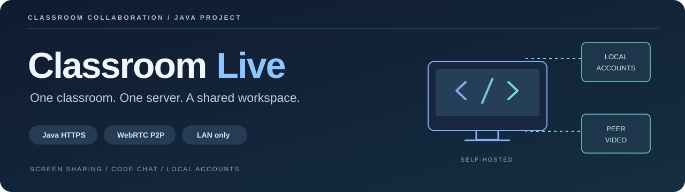
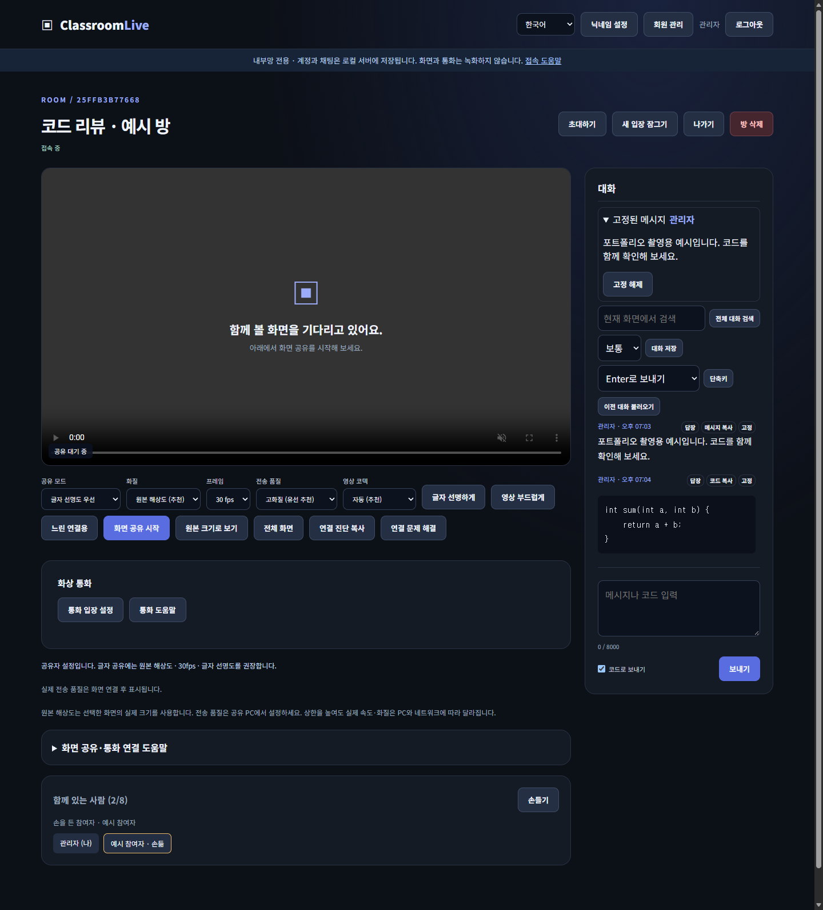
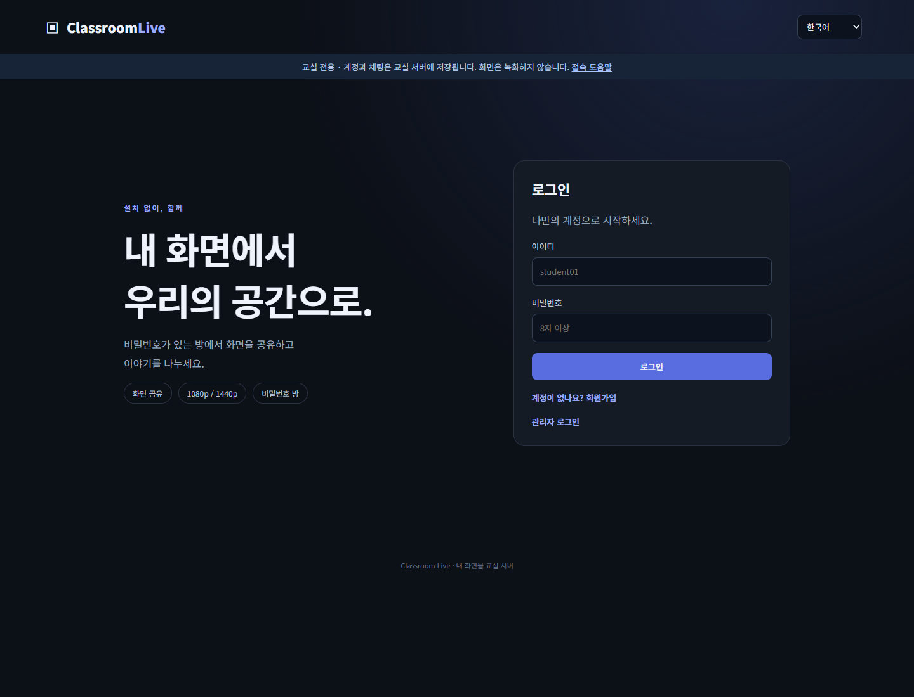
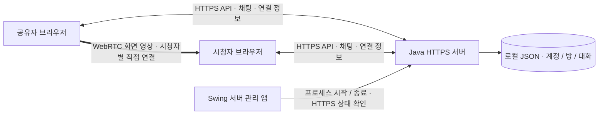

<div align="center">



# Classroom Live

### 교실 PC 한 대로 운영하는 화면 공유·코드 채팅 서비스

**Java HTTPS 서버 · WebRTC P2P · 교실 내부망 · 외부 서비스 없는 실행**

[포트폴리오 상세](docs/PORTFOLIO_KO.md) · [검증 기록](docs/VERIFICATION_2026-11-27.md) · [한국어 설치 안내](docs/guide-ko.md) · [English](README_EN.md)

**[포트폴리오 사이트 열기](https://breadhun0814.github.io/classroom-live-java/)** — 실제 앱 화면, 브라우저 예시 체험, 기술 설계와 검증 결과를 볼 수 있습니다.

[Windows 실행용 ZIP](downloads/ClassroomLive-Windows.zip) · [서버·학생 빠른 설치 안내](install.html) · [사이트 점검·설치 개선 기록](docs/AUDIT_INSTALL_2026-11-27.md)

</div>

## 프로젝트 소개

Classroom Live는 같은 교실의 사용자가 비밀번호 방에 모여 화면과 코드를 공유하는 내부망 웹 애플리케이션입니다. 서버 PC 한 대에서 Java를 실행하고, 참여자는 PC의 Chrome 또는 Edge로 접속합니다. 계정·방·대화는 교실 서버에 보관하며 영상은 공유자와 시청자 사이의 WebRTC 연결로 전달합니다.

**설치 부담을 줄이는 배포 구조와, 수업 운영에 필요한 계정·방·화면 공유 기능을 함께 구성한 프로젝트입니다.**

| 항목 | 내용 |
| --- | --- |
| 사용 환경 | PC 간 직접 통신이 허용된 교실 내부망 |
| 서버 | Java 17+ 및 `jdk.httpserver`, 초기 설정에 `keytool` 필요 |
| 클라이언트 | PC Chrome / Edge, Java 설치 불필요 |
| 방 구성 | 공유자 포함 최대 8개 동시 접속, 한 번에 한 명이 화면 공유 |
| 저장 방식 | 로컬 JSON 파일 + 메모리의 접속·화면 공유 상태 |
| 언어 | 한국어, 영어, 일본어, 중국어 간체, 베트남어 |

> 8개 접속은 코드에서 제한하는 방 정원입니다. 실제 8대 PC의 화질이나 처리 성능을 측정한 결과는 아닙니다.

## 실행 화면



*실제 Java HTTPS 서버에 관리자와 예시 학생이 접속한 화면입니다. 촬영용 합성 계정·대화를 사용했으며, 영상 영역은 화면 공유 대기 상태입니다.*

<details>
<summary>로그인 화면 보기</summary>



</details>

## 주요 기능

| 기능 | 구현 내용 |
| --- | --- |
| 계정과 권한 | 로컬 회원가입·로그인, 닉네임 변경, 단일 관리자, 이용 정지·복구 |
| 비밀번호 방 | 방 생성, 이름·초대 코드로 입장, 정원 확인, 방장 삭제·관리자 퇴장 처리 |
| 화면 공유 | WebRTC 직접 전송, 공유자 한 명 제한, 원본·720p·1080p·1440p와 프레임 설정 |
| 화상 통화 | 화면을 공유하면서 통화 가능. 입장 전 카메라 미리보기, 기기 선택, 듣기만 참여, 참여자별 음소거, 다시 연결 지원 |
| 화질 조절·진단 | 글자·움직임 프리셋, 코덱 선호도, 실제 전송 통계, 원본 크기 보기, 연결 진단 |
| 일반·코드 채팅 | 줄바꿈·코드 표시, 대화 검색·복사·저장, 이전 대화 불러오기, 방당 최근 1,000개 보관 |
| 운영 도구 | CA·서버 인증서와 학생 설치팩 생성, 백업·비밀번호 재설정, Swing 서버 관리 앱 |

## 시스템 구조



- **서버와 영상 경로 분리:** Java 서버가 인증·방·채팅과 연결 정보를 처리하고, 영상은 시청자별 P2P 연결로 전송합니다. SFU와 외부 STUN/TURN 서버는 사용하지 않습니다.
- **HTTPS 폴링 기반 동기화:** `/api/rpc`로 메시지·접속자·WebRTC 신호를 조회합니다. 정상 상태의 조회 간격은 응답 처리 후 약 1.8초이며, 실패 시 4초 후 재시도합니다.
- **영속 상태와 실시간 상태 분리:** 계정·방·대화는 JSON에 저장하고, 로그인 세션·참여자·공유 상태·신호는 메모리에서 관리합니다. 서버를 재시작하면 다시 로그인하고 방에 입장해야 합니다.

## 기술 구성과 설계 포인트

| 영역 | 기술·구현 | 적용 이유와 범위 |
| --- | --- | --- |
| 백엔드 | Java 17, JDK `HttpsServer`, Java Cryptography API | 별도 웹 프레임워크·DB 서버 없이 한 PC에서 실행 |
| 프론트엔드 | HTML, CSS, Vanilla JavaScript | UI와 정적 자원을 JAR에 함께 포함해 로컬 서버에서 제공 |
| 미디어 | `getDisplayMedia`, `RTCPeerConnection`, `getStats` | 화면 캡처·브라우저 간 영상 연결·전송 상태 진단 |
| 데이터 | JSON, 임시 파일 후 교체, `FileChannel` 잠금 | 작은 교실 환경에서 데이터 보관과 동일 폴더의 중복 실행 제어 |
| 인증·요청 검사 | PBKDF2-HMAC-SHA256, Secure·HttpOnly·SameSite 쿠키, Origin 검사 | 비밀번호 해시 저장, 세션 전달, 교차 출처 요청 제한 |
| 운영 | Swing, PowerShell/CMD, `keytool` | 서버 시작·종료와 인증서·설치팩 배포를 지원 |
| 개발 검증 | Java 테스트, Node.js 24, jsdom, Playwright 촬영 | 서버/API 및 UI 흐름 확인. Node.js는 교실 실행에 불필요 |

화면 공유의 이전 응답이 새 공유 상태를 덮어쓰지 않도록 `generation`·`epoch`·연결 ID를 확인합니다. ICE 후보가 먼저 도착하면 대기열에 보관하고, 원격 설명 설정 후 적용합니다. [상세 설계와 코드 근거](docs/PORTFOLIO_KO.md)에서 더 확인할 수 있습니다.

## 실행 방법

### Windows

1. [Windows 실행용 ZIP](downloads/ClassroomLive-Windows.zip)을 내려받아 사용할 폴더에 전체 압축을 풉니다.
2. **`Start-Classroom.cmd`를 더블 클릭**합니다. 기존 Java 17+ JDK를 자동으로 찾고, 없으면 공식 Eclipse Temurin 21을 `.runtime/java`에 다운로드·SHA-256 확인 후 준비할 수 있습니다. PATH·JAVA_HOME은 변경하지 않습니다.
3. 처음 한 번 감지된 교실 IP·허용 대역을 확인하고 포트·관리자 계정을 설정합니다. 방화벽 요청을 선택했다면 Windows의 관리자 권한 창을 직접 승인합니다.
4. 관리 앱이 열리며 서버가 자동 시작됩니다. 다음부터는 바탕화면 **Classroom Live 서버**를 더블 클릭하면 CMD 창 없이 켜집니다. 관리 창에서 서버 종료·재시작을 할 수 있습니다.
5. 학생에게 생성된 **`data/STUDENT_SETUP.zip`만** 전달합니다. 학생과 서버에서 브라우저를 쓰는 사용자는 이 설치팩으로 교실 CA를 등록하고 브라우저를 완전히 재시작한 뒤 접속합니다. 학생 PC에는 Java가 필요 없습니다.

Java 최초 다운로드에는 인터넷이 필요합니다. 방화벽 단계를 건너뛰었다면 학생 접속 전에 `03-Firewall.cmd`를 관리자 권한으로 실행하세요. 기존 수동 설치 파일도 유지했습니다.

간단한 절차: [서버·학생 설치 안내](install.html). 수동·다국어 절차: [한국어 설치 안내](docs/guide-ko.md). 콘솔 없이 운영하려면 [Windows 서버 관리 앱 안내](SERVER_APP_KO.md)를 확인하세요. 기존 서버 업데이트 시 `data`, `.runtime`, `java-path.txt`를 유지합니다.

### 소스 빌드와 개발 검증

```powershell
java Build.java test
java --add-modules jdk.httpserver -cp "build/classes;build/test-classes" ServerTests
```

`Build.java test`는 JAR 생성과 테스트 컴파일을 수행합니다. 테스트 실행 명령은 별도로 입력해야 합니다. 전체 Java·UI·다국어 검증 절차는 [TESTING.md](TESTING.md), Ubuntu 실행은 [English 설치 안내](docs/guide-en.md)를 참고하세요.

## 검증 결과와 한계

2026-11-27 Windows 환경에서 소스 빌드, Java 백엔드·실제 HTTPS·인증서 생성 테스트, jsdom UI 통합 테스트, 다국어 안내 테스트가 통과했습니다. 서버 프로세스 관리 테스트는 자식 프로세스 출력까지 UTF-8로 지정한 조건에서 통과했습니다. 실제 Edge에서 합성 계정의 로그인·회원가입·방 생성·입장·코드 채팅도 확인했습니다.

**UI 통합 테스트의 미디어 연결은 모의 객체입니다.** 실제 여러 PC의 영상 전송 품질·코덱·대역폭·장시간 수업은 이번 작업에서 검증하지 않았습니다. [실행 환경·명령·제한을 포함한 기록](docs/VERIFICATION_2026-11-27.md)을 제공합니다.

- 학교의 PC 간 통신 차단 정책에 따라 채팅은 되지만 영상이 연결되지 않을 수 있습니다.
- 시청자가 늘면 공유자 PC의 연결 수와 송신 부하가 증가합니다. 해상도·프레임·전송 상한은 실제 품질 보장값이 아닙니다.
- JSON 저장과 동기화된 저장소 연산은 소규모 사용을 위한 구성입니다. 대규모 동시 사용·고가용성은 검증하지 않았습니다.
- 첨부파일, 영상 녹화, 교실 사설 IP를 통한 집에서의 접속은 포함하지 않습니다.

## 저장소 안내

```text
src/                 Java 서버 · 프로세스 관리 · Swing 관리 앱
public/              실제 교실 웹 앱과 다국어 UI
tests/               Java · UI 통합 · 다국어 안내 테스트
scripts/             Windows 운영 도구 · 안내/번역 동기화
docs/                포트폴리오 · 검증 기록 · 언어별 가이드
Build.java           Java 17 대상 빌드와 테스트 컴파일
ClassroomLive.jar    UI가 포함된 서버 실행 파일
ServerControl.jar    서버 관리 앱 실행 파일
index.html           GitHub Pages 포트폴리오 · 브라우저 예시 체험
portfolio.css/js     포트폴리오 디자인과 로컬 예시 UI
START_HERE.html      5개 언어 오프라인 설치 안내
```

GitHub Pages의 `index.html`은 **포트폴리오와 로컬 예시 체험**입니다. 실제 서비스는 실행 중인 교실 서버의 HTTPS 주소에서 사용합니다. 기존 5개 언어 설치 안내는 [START_HERE.html](START_HERE.html)에 보존했습니다. 개발용 `scripts/sync-guides.cjs`도 이 파일을 기준으로 서버 도움말을 갱신하므로 포트폴리오를 덮어쓰지 않습니다.

**운영 자료 보관:** `data/`, 인증서 개인 키, 계정·채팅 데이터, 실제 `java-path.txt`는 공개하지 마세요. `.gitignore`에 제외 규칙을 추가했으며, GitHub 웹 업로드에는 제외 규칙이 자동 적용되지 않습니다.

다국어 설치 안내: [한국어](docs/guide-ko.md) · [English](docs/guide-en.md) · [日本語](docs/guide-ja.md) · [简体中文](docs/guide-zh-CN.md) · [Tiếng Việt](docs/guide-vi.md)
