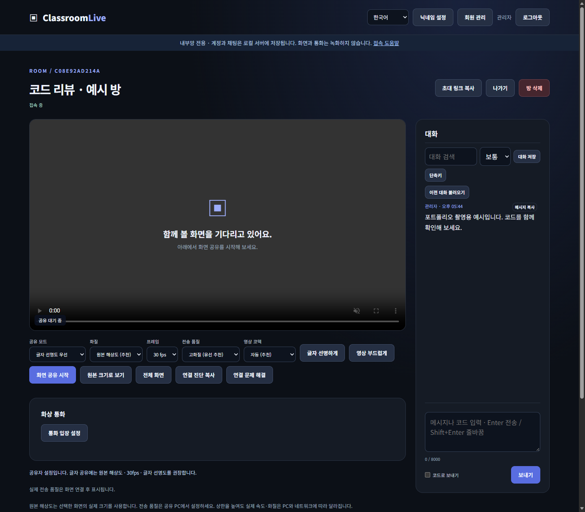

# Classroom Live | 내부망 화면 공유·화상 통화·코드 채팅

> Java 서버 한 대와 브라우저로 구성한 소규모 협업 도구. 외부 서비스 의존 없이 로그인부터 화면 공유·채팅·서버 관리까지 연결합니다.

[프로젝트 첫 화면](../README.md) · [소스 저장소](https://github.com/breadhun0814/classroom-live-java) · [검증 기록](VERIFICATION_2026-11-27.md)

**[포트폴리오 사이트와 브라우저 예시 체험](https://breadhun0814.github.io/classroom-live-java/)** · [사이트 구성·검증](PORTFOLIO_SITE_KO.md)

## 프로젝트가 다루는 문제

회의나 스터디에서 자료와 코드를 함께 보려면 영상 전달뿐 아니라 참여자의 접속, 방 입장, 대화 기록, 서버 시작과 종료까지 필요합니다. Classroom Live는 이 흐름을 한 대의 로컬 서버와 브라우저에 모았습니다. 서버에는 Java를 준비하고 참여자 PC에는 서버 인증서와 접속 안내를 제공하는 구조입니다.

이 설명은 저장소에서 확인한 구현을 바탕으로 정리했습니다. 개발 기간, 팀 구성, 개인 담당 범위, 실제 도입 인원은 코드만으로 확인할 수 없어 기재하지 않았습니다.

## 사용 흐름

1. **운영자 설정:** 서버 IP·허용 대역·관리자 계정을 입력하고 CA·서버 인증서와 참여자 설치팩을 생성합니다.
2. **참여자 접속:** 참여자 설치팩으로 서버 CA를 등록한 뒤, 브라우저에서 회원가입·로그인합니다.
3. **협업 공간 생성:** 비밀번호 방을 만들고 방 이름이나 초대 코드와 비밀번호로 입장합니다.
4. **화면과 코드 공유:** 한 명이 화면을 공유하며, 참여자는 일반 메시지와 코드 메시지를 주고받습니다.
5. **방 관리:** 관리자가 계정 이용 상태·참여자·방을 관리하고, 서버 PC에서 앱이나 명령으로 서버를 종료합니다.

*임시 합성 계정으로 촬영한 실제 UI입니다. 화면 공유 영역은 대기 상태이며 실제 운영 장면이나 다중 PC 영상 전송을 촬영한 자료가 아닙니다.*

## 화면 공유와 화상 통화 동작

| 사용자가 보는 화면 | 브라우저에서 하는 일 | Java 서버가 하는 일 |
| --- | --- | --- |
| 발표자의 화면 선택 창 | `getDisplayMedia()`로 탭, 창 또는 전체 화면을 영상 트랙으로 가져옵니다. | 방 참여 상태를 확인하고 현재 발표자를 한 명으로 제한합니다. |
| 방 상단의 공유 화면 | `RTCPeerConnection`으로 발표자 영상을 시청자에게 전송해 재생합니다. `getStats()`로 전송 상태를 표시합니다. | 두 브라우저가 주고받는 SDP와 ICE를 같은 방의 상대에게 전달합니다. |
| 공유 화면 아래의 화상 통화 | 카메라와 마이크를 각각 켤 때 `getUserMedia()`를 사용합니다. 같은 통화에 참여한 브라우저끼리 별도의 WebRTC 연결을 만듭니다. | 통화 참여 상태를 확인하고 현재 통화 회차에 해당하는 상대에게 연결 정보를 전달합니다. |

발표자 영상과 통화 미디어는 각각 다른 연결에서 전달됩니다. 같은 PC의 Edge 두 세션에서 합성 입력으로 동시 전송을 확인했고, 화면 공유를 중지해도 통화가 유지됐습니다. 통화에 다시 연결하거나 통화에서 퇴장한 뒤에도 화면 공유가 유지됐습니다. 실제 장비 조합, 다른 PC 간 전송 품질과 여러 명이 참여할 때의 성능은 추가 검증이 필요합니다.

같은 네트워크에서 PC 간 직접 통신이 가능해야 합니다. 공유 화면은 한 명이 여러 시청자에게 송신하고, 화상 통화는 참여자마다 별도의 상대 연결을 만들기 때문에 인원이 늘수록 네트워크와 PC 부하가 증가합니다. 8개 접속은 방 동시 접속 제한입니다.

근거: [브라우저 미디어 연결 코드](../public/web/app.js), [서버의 방 상태와 미디어 신호 처리](../src/ClassroomServer.java), [공개 사이트의 기술 설명](https://breadhun0814.github.io/classroom-live-java/#architecture).

## 핵심 구현 1 · 배포 단위를 줄인 Java 서버

서버는 JDK의 `HttpsServer`로 HTTPS API와 정적 UI를 함께 제공합니다. Java 소스 세 개와 `public/` 자원을 빌드해 `ClassroomLive.jar`로 묶으며, 서버 실행에 Spring·Maven·Gradle·Node.js나 별도 DB 서버를 요구하지 않습니다. 초기 인증서 생성에는 JDK의 `keytool`을 사용합니다.

이 구성은 배포 요소를 줄이는 데 유리합니다. 대신 인증·요청 검증·JSON 처리·저장소를 직접 유지해야 하며, 코드가 `ClassroomServer.java`에 집중되어 있어 기능이 늘면 분리할 필요가 있습니다.

근거: [Build.java](../Build.java), [ClassroomServer.java의 Service·Json·certificates](../src/ClassroomServer.java).

## 핵심 구현 2 · 제어 정보와 화면 영상의 경로 분리

계정, 방, 채팅, SDP와 ICE 후보는 동일 출처 HTTPS API를 사용합니다. 브라우저는 `live_room_state`를 폴링해 변경 사항을 받아옵니다. 화면 영상은 공유자와 각 시청자의 `RTCPeerConnection` 사이로 직접 전송합니다.

외부 STUN/TURN 요청 없이 LAN의 host 후보를 사용하는 구조이므로, PC 간 직접 통신이 가능한 내부망을 전제로 합니다. 영상 중계 서버를 운영하지 않는 대신 시청자 수에 따라 공유자의 송신 부하가 커지고, 네트워크 격리가 있는 환경에서는 연결이 실패할 수 있습니다. 정상 폴링도 응답 처리 후 약 1.8초 간격이어서 채팅·상태 변경에 지연이 생길 수 있습니다.

근거: [app.js의 poll·loadIce·newPeer·receiveSignal](../public/web/app.js), [동일 출처 API 어댑터](../public/web/local-api.js), [ClassroomServer.java의 live_room_state·live_send_signal](../src/ClassroomServer.java).

## 핵심 구현 3 · 비동기 화면 공유의 상태 구분

화면 공유를 중단하고 다시 시작하면 이전 요청의 응답이나 ICE 후보가 늦게 도착할 수 있습니다. 구현에서는 다음 값을 확인해 현재 화면 공유에 속한 작업인지 구분합니다.

| 상태 값 | 역할 |
| --- | --- |
| `generation` | 현재 방/UI 수명에 해당하는 비동기 작업인지 확인 |
| `epoch` | 서버가 발급한 현재 공유 회차인지 확인 |
| `connectionId` | 동일 상대의 재연결 중 어느 연결에 속한 신호인지 확인 |
| `pendingIce` | 원격 설명보다 먼저 도착한 ICE 후보를 보관한 뒤 순서대로 적용 |

송신 화질 설정도 협상 전후를 구분합니다. 원격 answer를 반영한 뒤 송신 인코딩의 비트레이트·프레임 상한을 적용하며, 코덱 선호도와 캡처 제약을 지원하지 않으면 가능한 설정으로 진행하는 경로를 둡니다. 이 동작은 모의 미디어를 사용하는 UI 테스트로 확인한 범위이며 실제 브라우저 조합별 품질 검증은 별도로 필요합니다.

근거: [app.js의 poll·configureSender·drainIce·receiveSignal](../public/web/app.js), [ui.test.cjs](../tests/ui.test.cjs).

## 핵심 구현 4 · 데이터 보관과 접근 검사

계정·방·대화는 `classroom-data.json`에 저장합니다. 임시 파일에 쓴 뒤 교체하며, 파일 시스템이 지원하면 원자적 이동을 사용합니다. 별도 파일 잠금으로 같은 데이터 폴더를 두 서버가 동시에 사용하는 것을 제한합니다. 로그인 세션·참여자·화면 공유·연결 신호는 메모리에 두어 재시작 시 초기화합니다.

비밀번호는 사용자별 salt와 PBKDF2-HMAC-SHA256 600,000회로 해시합니다. 세션은 Secure·HttpOnly·SameSite=Strict 쿠키로 전달하며, API에서 Origin·커스텀 헤더·허용 IP 대역과 권한을 확인합니다. 참여자 설치팩에는 공개 CA 인증서와 접속 안내를 넣고 서버 개인 키는 포함하지 않도록 구성했습니다.

이는 구현과 자동 테스트로 확인한 보호 장치입니다. 독립적인 보안 감사나 운영 환경의 안전성을 입증하는 결과는 아닙니다. JSON 파일 전체 저장과 `synchronized` 연산이 있으므로 대규모 트래픽에 대한 성능 주장도 하지 않습니다.

근거: [ClassroomServer.java의 hash·atomic·Store·Service.handle·studentPack·main](../src/ClassroomServer.java), [ServerTests.java](../tests/ServerTests.java).

## 핵심 구현 5 · 서버 운영을 위한 데스크톱 관리 앱

Swing 관리 앱은 서버를 자식 프로세스로 시작하고 로그와 HTTPS 상태를 표시합니다. 종료 버튼은 자식 프로세스의 표준 입력 파이프로 `STOP`을 전송합니다. 부모의 파이프가 닫히는 경우에도 관리 모드 서버가 종료하도록 구성했습니다.

별도 작업 디렉터리에서 실행해도 JAR의 위치를 기준으로 서버 폴더를 찾습니다. 기존 계정·설정·인증서·참여자 설치팩이 보존되는지와 중복 실행·정상 종료·재시작은 프로세스 관리 테스트로 확인했습니다. Windows 바탕화면 바로가기와 창 없는 실행을 사용자가 직접 조작하는 검증은 이번 작업에서 수행하지 않았습니다.

근거: [ServerControl.java](../src/ServerControl.java), [ManagedServer.java](../src/ManagedServer.java), [ManagedServerTests.java](../tests/ManagedServerTests.java).

## 확인한 결과

| 확인 항목 | 이번 작업의 결과 |
| --- | --- |
| Java 소스 빌드와 테스트 컴파일 | 통과 |
| 백엔드·권한·동시 입장 정원·저장·실제 HTTPS·인증서·참여자 설치팩 테스트 | 통과 |
| 실제 HTTPS 백엔드 + jsdom UI 통합 테스트 | 통과, 미디어는 모의 객체 |
| 5개 언어 설치 안내·언어 전환 테스트 | 통과 |
| 서버 자식 프로세스 시작·종료·재시작·데이터 보존 | UTF-8 출력 환경에서 통과 |
| 실제 Edge의 로그인·가입·방 생성·입장·코드 채팅 | 한 PC의 두 브라우저 컨텍스트로 확인 |
| 여러 PC의 화면 공유 품질·8대 PC 동시 영상·장시간 사용 | 미검증 |

실행 명령과 환경 제약은 [검증 기록](VERIFICATION_2026-11-27.md)에 정리했습니다. 테스트 정원 확인을 “8명 영상 전송 성능 검증”으로 해석하지 않습니다.

## 다음 개선 방향

- **현장 측정:** 참여자 PC 2대부터 영상 연결·글자 가독성·프레임·대역폭을 측정한 뒤 접속 수를 늘리고, 장시간 재연결·공유 전환을 기록합니다.
- **코드 구조:** 인증·방·채팅·저장소·HTTP 처리를 파일 또는 모듈로 분리해 변경 범위와 테스트 대상을 명확히 합니다.
- **동기화와 저장:** 사용 규모가 커지면 폴링 지연과 전체 JSON 저장 비용을 먼저 측정하고, 지속 연결이나 트랜잭션 저장소의 도입을 검토합니다.
- **운영 확인:** 실제 Windows의 바로가기·콘솔 없는 시작·종료와 참여자 인증서 설치 과정을 별도 PC에서 확인합니다.

위 항목은 향후 개선 제안이며 현재 완료된 기능이나 실적이 아닙니다.

## 포트폴리오에 붙여 넣을 짧은 소개

> Java 17 HTTPS 서버와 Vanilla JavaScript, WebRTC로 구성한 소규모 내부망 협업 프로젝트입니다. 비밀번호 방, 로컬 계정과 관리자 권한, 코드 채팅, 화면 공유, 화상 통화와 연결 진단, Swing 서버 관리 앱을 제공합니다. 서버가 인증·채팅·연결 정보를 담당하고 영상은 브라우저끼리 직접 전송합니다. Java 백엔드·HTTPS와 모의 미디어 기반 UI 통합 테스트를 확인했으며, 실제 여러 PC의 영상 품질과 장시간 사용 성능은 별도 검증이 필요합니다.

개인 포트폴리오에는 실제 개발 기간·팀 규모·본인이 담당한 기능과 코드 범위를 확인한 뒤 덧붙이면 됩니다.
